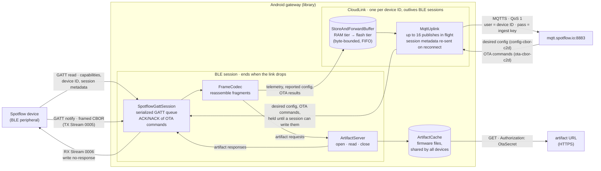
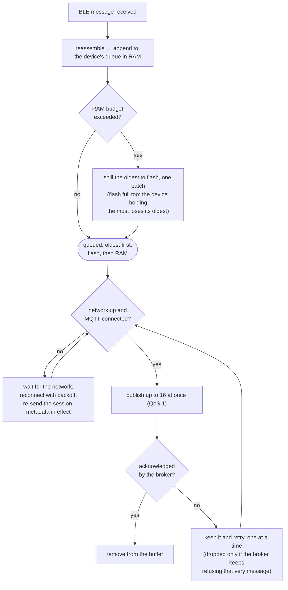

# Spotflow Android BLE Gateway

A reusable Android library (Kotlin, shipped as an AAR) that turns any Android app into a **Spotflow BLE
gateway**: it connects to devices running the [Spotflow Device SDK](https://github.com/spotflow-io/device-sdk)
with the BLE transport enabled and relays their diagnostics (logs, metrics, core dumps, configuration) to
the Spotflow cloud over MQTT — **while the screen is off**, **across reconnects**, and **through network
outages**. It speaks version 1.1 of the Spotflow BLE protocol, **over-the-air (OTA) firmware updates**
included: it relays a device's update commands and results and downloads its firmware on its behalf (see
[OTA updates](#ota-updates)).

The goal is drop-in integration for hardware vendors who already ship an Android companion app (e.g. a
smart thermostat): add the library, hand it a connection or let it scan, and their BLE devices show up in
Spotflow.

> **Download:** each [GitHub Release](../../releases) (published automatically on every `v*` tag) attaches
> the demo **APK** (sideload to try the gateway) and the library, as a **Maven repository zip** (the way
> to add it to an app, see [Adding the library](#adding-the-library)) and as a bare `.aar`.

## Modules

| Module | Purpose |
| --- | --- |
| `spotflow-ble-gateway` | The reusable library (`io.spotflow.ble`), published as an AAR. |
| `app` | A reference gateway app that uses the library. |

### Demo app

Open **Settings** (gear icon, top right), enter an ingest key, optionally size the buffer (RAM and flash,
in MB, shared by all devices), and tap **Save**; then tap **Start**. Settings can be changed while the
gateway runs: it keeps relaying with the old ones, and the main screen offers a **Restart** that applies
them within seconds (instead of a Stop/edit/Start round that leaves devices waiting). The app runs the
gateway in the foreground service and the main screen lists every device it relays — tap a name to
collapse or expand its details — with a status marker (green when relaying), its BLE and MQTT state,
signal strength, messages waiting to upload, **Forwarded** (messages delivered to the cloud) and
**Received** (desired configuration received from the cloud, e.g. a log-severity change made in the
portal). While no device is listed it says what discovery is doing (scanning, waiting for Bluetooth,
retrying a failed scan). The header shows the app version, and a line under **Devices** shows the
gateway-wide buffer use against the limits in Settings (amber above 80%; it says so when there is no
network). The ingest key is stored encrypted with the Android Keystore, and a gateway left running
resumes by itself after the app is updated or the phone reboots.

The demo relays every Spotflow device in range. An app for real devices passes a `DeviceFilter` that
accepts only its own — see the security note under [Managed mode](#managed-mode-library-owns-the-connection).

## How it works



Received BLE messages are reassembled and **buffered RAM-first** (spilling to a flash tier only once the
RAM tier is full, i.e. during longer outages), then a drainer publishes them to MQTT when the network is
available — so data survives outages, the flash isn't worn in steady state, and BLE ingestion never
blocks on the network.

The cloud side of each device (its buffer, MQTT connection and drainer — `CloudLink`) is independent of
the BLE connection: when a device disconnects, its link keeps uploading whatever is still buffered and
then closes; if the device reconnects meanwhile, the new session takes over the still-connected link.
Buffers left on disk by an earlier run are uploaded as soon as the gateway is created, even if those
devices never come back.

### Protocol

- **GATT** service `26530001-81E5-4861-82AE-2C92E6887922`, characteristics: Capabilities (`0002`),
  Device ID (`0003`), Session Metadata (`0004`), TX Stream `NOTIFY` (`0005`), RX Stream `WRITE`-no-response
  (`0006`).
- **Connection order** — as the protocol specifies: discover services and negotiate MTU, read
  Capabilities, Device ID and Session Metadata, and only then enable TX Stream
  notifications. (Some devices stop answering reads once their TX stream is running.)
- **Link parameters** — if a device requests a supervision timeout shorter than 2 s (seen: 420 ms, which
  drops the link on any brief radio gap), the gateway asks Android for balanced connection priority, which
  renegotiates a 5 s timeout. Managed mode only.
- **Framing** — a message may exceed the negotiated ATT MTU (as low as 23 bytes), so it is split into
  fragments. `FrameCodec` handles fragmentation (outgoing) and reassembly (incoming). Flags: `IS_FIRST`
  (`0x01`), `IS_LAST` (`0x02`), `NEEDS_ACK` (`0x04`, protocol 1.1: the receiver answers with an
  `ACK`/`NACK` control frame; the gateway sets it on OTA commands, and drops a message whose fragments
  disagree on it). The other bits are reserved and ignored.
- **Protocol version** — the gateway speaks protocol 1.1 and works with 1.0 devices. Capabilities holds
  the major and minor version and, from 1.1, a feature byte whose bit 0 says the device takes OTA updates
  through the gateway. Such a device gets them (see [OTA updates](#ota-updates)); any other is relayed
  for telemetry and configuration only.
- **Encryption** — a device can require an encrypted (paired) link for everything but Capabilities; the
  Device SDK does by default when built with OTA. Pair (bond) such a device with the phone, or the
  session fails with a `BLUETOOTH` error saying so.
- **Message types** — `TELEMETRY` (`0x02`), `REPORTED_CONFIGURATION` (`0x03`),
  `DESIRED_CONFIGURATION` (`0x04`). Telemetry payloads carry logs, metrics **and core-dump chunks**; the
  gateway relays them opaquely (CBOR is not parsed). OTA uses `OTA_D2C` (`0x05`, results), `OTA_C2D`
  (`0x06`, commands), `ARTIFACT_REQUEST` (`0x07`) and `ARTIFACT_RESPONSE` (`0x08`), and the unfragmented
  `ACK`/`NACK` control frames (`0x00`/`0x01`) with which the device answers OTA commands. Anything a
  device sends that is not its to send (or an OTA message from a device without OTA) is dropped.
- **Cloud** — one MQTT-over-TLS connection per device to `mqtt.spotflow.io:8883`, QoS 1, with MQTT
  `username = device ID` and `password = ingest key`. TLS is validated by the Android system trust store
  (Let's Encrypt ISRG Root X1 — no bundled CA). Telemetry and session metadata publish to `ingest-cbor`,
  reported configuration to `config-cbor-d2c`, OTA results to `ota-cbor-d2c`; desired configuration
  (e.g. the minimal log severity set in the portal) is received from `config-cbor-c2d` and written down
  the RX Stream, in order, and acknowledged to the broker only once written. OTA commands arrive on
  `ota-cbor-c2d`, subscribed to only for devices that take OTA updates.
- **Session metadata** is read from the device at the start of every BLE session and published ahead of
  its telemetry. The cloud applies it per MQTT connection, so after a reconnect the gateway publishes the
  one in effect again before anything else.
- **Desired configuration details** — the broker publishes it on a per-device topic *below* the
  subscribed one (`config-cbor-c2d/<workspace>/<device>`), so, like the Device SDK, the gateway matches
  the topic by prefix. It is written only after the device has sent its reported configuration in the
  current session: the Device SDK discards desired configuration that arrives earlier. Until then it
  stays queued and unacknowledged, so nothing is lost while the device is away.
- **Desired configuration after a device reboot** — the broker sends desired configuration only when an
  MQTT connection is established (a device on MQTT directly gets it again on every reboot). Because the
  gateway keeps a device's MQTT connection across BLE reconnects, it remembers the last configuration
  written to the device and writes it again at the start of each session, unless newer configuration is
  pending — so a rebooted device, which starts from its compiled defaults, is brought back in sync.
- **Upload** — up to 16 messages are in flight at once, sent in order, so throughput is not bound to one
  network round trip per message.
- **Delivery** is at-least-once: when a connection is lost, the messages still waiting for their
  acknowledgement may or may not have reached the broker, and are sent again — so they can arrive twice.
- **Reassembly** only delivers a message whose size matches the length declared in its first fragment;
  a message with a lost fragment is dropped rather than forwarded truncated.

### OTA updates

Protocol 1.1 lets a device take firmware updates through its gateway, and this one relays them for every
device whose Capabilities advertise OTA (turn that off with `OtaConfig(enabled = false)`). The update is
deployed in the Spotflow portal as for any other device; the gateway carries three things:

- **Commands** — the gateway subscribes to the device's OTA commands (`ota-cbor-c2d`) once its session
  metadata is published, the order the Device SDK follows on MQTT, and subscribes again on every new MQTT
  connection and every BLE session: the cloud resends an unfinished update on each subscription, which is
  how a rebooted device picks it up again. Each command is written down the RX Stream as `OTA_C2D` with
  `NEEDS_ACK`, one at a time. The device answers `ACK` or `NACK`; a `NACK`, or no answer within 5 s,
  retransmits the same message (same sequence number) after a backoff growing from 1 to 30 s. A command is
  acknowledged to the broker only once the device has acknowledged it; one the device did not get waits,
  unacknowledged, for its next session. Commands are forwarded unchanged: the gateway does not parse the
  manifest.
- **Results** — the device's `OTA_D2C` messages are published to `ota-cbor-d2c`, through the same
  store-and-forward buffer as telemetry.
- **Firmware** — the device fetches the artifact through the gateway in blocks (`ARTIFACT_REQUEST`: open,
  read, close; answered with `ARTIFACT_RESPONSE`). On open, the gateway downloads the whole artifact over
  HTTPS from the URL in the request, with `Authorization: OtaSecret <secret>`, into the app's cache
  directory, and answers every read from that file — so a transfer reopened after a timeout or a
  reconnect gets exactly the same bytes, as the protocol requires.
  - One download per artifact, shared by every device updating to it. It carries on when the device gives
    up waiting (the Device SDK repeats a request every 2 s for up to 120 s, then opens a new transfer and
    resumes from where it was) or disconnects; the device's next open finds it done.
  - HTTPS only. Redirects are followed, but the secret goes only to the URL's own host. A download cut
    off midway resumes with an HTTP range request.
  - An artifact over `OtaConfig.maxArtifactBytes` (32 MiB by default, the Web App gateway's limit) is
    refused as too large. Download failures are reported to the device as "access denied" (HTTP 401, 403,
    404) or "transient failure" (network, HTTP 5xx), which the Device SDK retries with backoff.
  - Up to four artifacts are kept, the least recently opened dropped first. They are deleted when the
    gateway shuts down, and anything left by an earlier run before the first download.
  - URLs and secrets never appear in logs.

`GatewayDeviceState.otaEnabled` says whether a device takes updates through the gateway, and
`otaTransfer` shows the transfer under way: the artifact's size (null while the gateway is still
downloading it) and how much of it the device has read. The demo app shows both.

The gateway handles the download credentials and decides which bytes reach the device, but it does not
vouch for the firmware: that is checked on the device (its update handler and bootloader verify the
image). The Device SDK requires an encrypted link when built with OTA, so pair such a device with the
phone (see **Encryption** above).

### Package layout (`spotflow-ble-gateway/src/main/java/io/spotflow/ble`)

The library is built in Kotlin's explicit-API mode: what is public is public on purpose, and
`spotflow-ble-gateway/api/spotflow-ble-gateway.api` records it (CI fails if the two disagree). Everything
else is internal.

- **Public** — `SpotflowGateway`, `GattAttachment`, `DeviceFilter`, `GatewayDeviceState` / `DeviceError`,
  `GatewayStatus` / `ScanState`, `SpotflowLog`; `cloud/` `MqttConfig` / `SpotflowTopics` / `PublishQos`,
  `OtaConfig` / `OtaTransfer`, `CredentialsProvider` + `StaticIngestKey`, `BufferUsage`;
  `transport/ConnectionState`;
  `protocol/GattProfile` (the UUIDs); `service/SpotflowGatewayService`.
- `protocol/` — `MessageType`, `Message`, `FrameCodec`, `DeviceCapabilities`, `ArtifactProtocol` (pure
  JVM, unit-tested).
- `transport/` — `BleConnection` (with `ManagedBleConnection` / `AttachedBleConnection`),
  `SpotflowGattSession` (serialized GATT command queue + callback bridge), `SpotflowScanner`.
- `cloud/` — `MqttUplink` (behind the `Uplink` interface), `StoreAndForwardBuffer` (a device's two-tier
  RAM+flash queue) within `BufferPool` (the gateway-wide RAM and flash budget), backed by `MessageStore`
  (the shared SQLite flash tier).
- `ota/` — `ArtifactServer` (a BLE session's artifact transfers), `ArtifactCache` (the gateway's
  downloaded artifacts), `HttpArtifactDownloader` (behind the `ArtifactDownloader` interface).
- `GatewaySession` (BLE side), `CloudLink` / `CloudLinkRegistry` (per-device cloud side that outlives BLE
  sessions) — orchestration. `GatewayPlatform` is the seam between that logic and Android (adapter,
  scanner, GATT, connectivity, MQTT client), which is what lets the reconnect logic be unit-tested.

## Adding the library

The library needs an app on **Kotlin 2.1 or newer**, with `minSdk` 26 and `compileSdk` 35 or newer.

The library is not on Maven Central yet. Each release attaches
`spotflow-ble-gateway-<tag>-maven.zip`: a Maven repository holding the AAR **and its POM**, so Gradle
resolves the library's own dependencies (the MQTT client, coroutines, AndroidX core). Unzip it into your
project — say `spotflow-maven/` — and point Gradle at it:

```kotlin
// settings.gradle.kts
dependencyResolutionManagement {
    repositories {
        google()
        mavenCentral()
        maven { url = uri("$rootDir/spotflow-maven") }
    }
}

// app/build.gradle.kts
dependencies {
    implementation("io.spotflow:spotflow-ble-gateway:<version>")
}
```

If you take the bare `.aar` instead (`implementation(files("libs/….aar"))`), it comes with no dependency
information; add what it needs yourself, or the app crashes with `NoClassDefFoundError` at runtime:

```kotlin
implementation("org.jetbrains.kotlinx:kotlinx-coroutines-android:1.11.0")
implementation("androidx.core:core-ktx:1.16.0")
implementation("com.hivemq:hivemq-mqtt-client:1.4.2")
```

Either way, the MQTT client pulls in several Netty jars that ship colliding `META-INF` entries, which
fails the build ("2 files found with path…") until they are excluded:

```kotlin
android {
    packaging {
        resources {
            excludes += setOf(
                "META-INF/INDEX.LIST", "META-INF/DEPENDENCIES",
                "META-INF/LICENSE", "META-INF/LICENSE.txt", "META-INF/NOTICE", "META-INF/NOTICE.txt",
            )
            pickFirsts += setOf("META-INF/io.netty.versions.properties", "META-INF/native-image/**")
        }
    }
}
```

R8 / ProGuard rules come with the library (CI builds the demo shrunk by R8 to check them). Coming from
0.1.x? See the migration notes in [CHANGELOG.md](CHANGELOG.md).

## Quick start

### Managed mode (library owns the connection)

```kotlin
val gateway = SpotflowGateway(
    context,
    StaticIngestKey("<ingest-key>"),
    deviceFilter = { address, deviceId -> deviceId in myProvisionedDevices },
)
gateway.startScanning() // scans for the Spotflow service, connects, relays, reconnects
```

> **Security — the `deviceFilter` is required for a reason.** Managed mode connects to anything that
> advertises the Spotflow service, and the BLE protocol does not authenticate devices. A filter that
> accepts everything (`DeviceFilter.AcceptAll`, fine for a demo or a lab) lets any nearby peripheral
> publish data under any device ID in your workspace, using your ingest key, and receive that device's
> desired configuration. The gateway also refuses a second live session for a device ID that is already
> connected, and never relays a device with an empty ID.

A device the filter rejects is disconnected and left alone; it is asked about again after ten minutes,
or right away after `gateway.retryStopped()` — call that when what the filter accepts has changed (the
user signed in, a device was provisioned). `gateway.detach(address)` takes a device out for good: the
scan leaves it alone until `retryStopped()`.

### Attach mode (host already owns the connection)

For apps that already hold a `BluetoothGatt` to the same device and don't want a second connection. It
takes two steps, so that the gateway never issues a GATT operation before its callbacks can reach it:

```kotlin
val attachment = gateway.newAttachment()

// 1. Wire its callback. Either pass it to connectGatt…
val gatt = device.connectGatt(context, false, attachment.gattCallback, BluetoothDevice.TRANSPORT_LE)
// …or, if you have a callback of your own, forward every event it receives to attachment.gattCallback.

// 2. Start relaying. The GATT may still be connecting; the gateway waits for the link.
attachment.start(gatt)
```

**Host contract for attach mode:**
1. `attachment.gattCallback` must receive **every** event of the GATT — if you fan out from your own
   callback, forward all of them, including both the API 33+ and the older overloads of
   `onCharacteristicRead` and `onCharacteristicChanged`.
2. Run your own GATT operations inside `attachment.runExclusive { gatt -> ... }` while attached — the
   Android BLE stack allows only one outstanding GATT operation at a time, and this serializes yours with
   the gateway's. (As a second line of defence the gateway ignores results for characteristics it did not
   ask about.) The gateway doesn't poll RSSI on an attached connection unless you ask for it with
   `newAttachment(pollRssi = true)`.
3. The host owns connect/disconnect and reconnection. A relaying session ends when the link drops; call
   `attachment.start(gatt)` again when it is back — the callback stays valid, so a GATT reconnected with
   `gatt.connect()` needs no rewiring.
4. `attachment.detach()` stops relaying and tells the device to stop streaming; the link stays up.
5. An attachment relays one device at a time; create one per device to relay several.

### Background operation (screen off)

Run the gateway from the bundled foreground service:

```kotlin
SpotflowGatewayService.gatewayFactory = { ctx -> SpotflowGateway(ctx, StaticIngestKey(key), deviceFilter) }
SpotflowGatewayService.onReady = { it.startScanning() }
SpotflowGatewayService.start(context)
```

To apply new settings, update the hooks and call `SpotflowGatewayService.restart(context)`: it replaces
the gateway in place while the service stays in the foreground, so relaying pauses only while devices
reconnect. Data the old gateway held is written to flash and delivered by the new one — also for devices
that don't reconnect.

`SpotflowGatewayService.gatewayFlow` is a `StateFlow` of the gateway the service hosts (null while it
isn't running); collect it to follow the gateway across restarts.

It runs as foreground service type `connectedDevice` with a persistent (customizable) notification. For a
dedicated always-on gateway, also guide users to disable battery optimization (Doze) for the app.

The service is `START_STICKY`, so Android recreates it after killing the process — but in a fresh process
the static `gatewayFactory` / `onReady` hooks are unset. **Set them from `Application.onCreate()`**
whenever the gateway should be running (the demo's `GatewayApp` does this from a persisted flag);
otherwise the restarted service stops itself and relaying ends until the app is opened again.

### Observing the gateway

```kotlin
gateway.devices      // StateFlow<Map<address, GatewayDeviceState>>: BLE and cloud state, counters, error
gateway.status       // StateFlow<GatewayStatus>: scan state (and why it failed), network, storage
gateway.bufferUsage  // StateFlow<BufferUsage>: RAM and flash use against the limits
```

- `GatewayDeviceState.error` is typed: `DeviceError.kind` is one of `AUTH_REJECTED`, `CLOUD_UNREACHABLE`,
  `BLUETOOTH`, `DUPLICATE_DEVICE`, with a message for display. All of them are retried.
- `GatewayStatus.scan` says whether discovery is running — `SCANNING`, `WAITING_FOR_BLUETOOTH`,
  `RETRYING` (with `scanError`, e.g. a missing permission) or `STOPPED`.
- Signal strength (`rssi`) is sampled only while something collects `devices`.
- `otaEnabled` and `otaTransfer` show whether a device takes OTA updates through the gateway and how far
  the transfer of its firmware has got (see [OTA updates](#ota-updates)).
- The library logs to logcat at `INFO` and above, and its lines can contain device IDs. Route them
  elsewhere, raise the threshold or silence them through `SpotflowLog.logger` / `SpotflowLog.minPriority`.

## Resilience



- **Reconnect** — a dropped BLE link is reconnected automatically: right after a working session drops,
  with a direct connect (about a second when the device is still in range); if that fails, with
  `autoConnect` so Android re-attaches the moment the device reappears, with exponential backoff. A
  device that stays away for 10 minutes is released (freeing one of Android's limited GATT client slots)
  and picked up again by the scanner when it reappears.
- **Discovery** — the scan runs for the life of the gateway, so it is frugal: `BALANCED` for the first two
  minutes, to find what is in range quickly, then low-power (known devices reconnect through
  `autoConnect`, so the scan only has to notice new ones). It is restarted every 25 minutes, inside the
  30 minutes after which Android throttles a scan, and a scan that fails — which Android reports once and
  never again — is retried with backoff rather than leaving discovery dead until Bluetooth is toggled.
- **Network** — the gateway watches the phone's connectivity: with no network, uploads wait for one
  instead of retrying, and they resume the moment it is back rather than at the end of a backoff. A
  connection that drops is noticed as it happens — also during a quiet period — and re-established, and
  the device's session metadata is published on it first, since the cloud applies it per connection.
- **Store-and-forward buffer** — a two-tier buffer keeps diagnostics flowing through outages without
  wearing the flash. In steady state messages flow through a small **RAM tier only** (no disk writes);
  once the RAM tier fills (`ramBufferMaxBytes`, default 1 MiB — i.e. the network has been down a while) the
  oldest messages **spill to a crash-safe, byte-bounded SQLite tier** that survives the app being killed
  or the phone rebooting. Flash is written, read and cleared in batches (one transaction each), so an
  outage costs occasional flash writes rather than several per message. Total size is bounded by
  `bufferMaxBytes` (default 50 MiB), and everything drains in FIFO order once connectivity returns —
  whether or not the device is still connected. With `bufferMaxBytes` ≤ `ramBufferMaxBytes` there is no
  flash tier at all (RAM-only). Trade-off: data still in the RAM tier is lost if the process is killed.
  Sizes count each message's payload plus an estimate of the overhead of holding it, so the limits track
  real use even when messages are tiny.
- **Shared budget, fair eviction** — both limits apply to the **whole gateway**, however many devices it
  relays, so its footprint is predictable. Each device still has its own queue (it uploads over its own
  MQTT connection, in its own order, and one device's outage never blocks another's uploads), but all
  queues draw on the same budget: when RAM is full, the device holding the most RAM spills first; when
  flash is full, the device holding the most flash loses its oldest messages first. A device that floods
  the buffer or stays offline for long therefore gives up its own data before anyone else's. All devices
  share one database (`spotflow_buffer.db`); buffers in the per-device files of versions before 0.1.8 are
  moved into it on first start.
- **Storage trouble** — the database is opened in the background, never on the thread that creates the
  gateway. If it cannot be opened (storage full or failing), the gateway keeps relaying with the RAM tier
  only and says so in `GatewayStatus.storageAvailable`.
- **Bluetooth off/on** — the gateway watches the Bluetooth adapter itself, so turning Bluetooth off and
  back on tears down and re-establishes sessions automatically — even with the screen off, since it runs in
  the foreground service. (Turning Bluetooth off often doesn't deliver a GATT disconnect callback, which
  would otherwise leave a session parked forever.) The demo app additionally prompts to enable Bluetooth
  before starting and shows a tappable banner if it's turned off while running.
- **Cloud errors** — a rejected ingest key surfaces as `DeviceError.Kind.AUTH_REJECTED` with the broker's
  CONNACK reason (e.g. `BAD_USER_NAME_OR_PASSWORD`). Instead of hammering the broker, the gateway asks the
  `CredentialsProvider` again after a pause that grows from one to fifteen minutes — so a rotated or
  corrected key is picked up — or at once on `retryStopped()`, which also retries the upload of data
  buffered for devices that are no longer around.
- **Poison messages** — a message the broker keeps refusing is dropped after 5 refusals; one the broker
  answers by hanging up, or never acknowledges, after 10 — so it can't block the rest of the buffer. This
  is judged only while that message is the only one in flight, so a bad message never takes its
  neighbours with it. A connection lost to the network, or a broker that refuses because the workspace is
  over its quota, never counts against a message.
- **Slow and dead uplinks** — an uplink counts as stalled when nothing at all is acknowledged for 20 s,
  not when one message takes long: a slow link working through a window of core-dump chunks is left
  alone, a dead one is reconnected.

## Configuration

```kotlin
val gateway = SpotflowGateway(
    context,
    credentials = StaticIngestKey(key),   // or implement CredentialsProvider for rotation / per-device keys
    deviceFilter = myFilter,
    mqttConfig = MqttConfig(
        bufferMaxBytes = 50L * 1024 * 1024,     // store-and-forward buffer, all devices (RAM + flash)
        ramBufferMaxBytes = 1L * 1024 * 1024,   // RAM tier, all devices; spills to flash only past this
        keepAliveSeconds = 60,                  // per device connection; shorter costs battery
        // host / port / qos / topics are configurable; defaults target production
    ),
    otaConfig = OtaConfig(
        enabled = true,                         // relay OTA updates of devices that support them
        maxArtifactBytes = 32L * 1024 * 1024,   // largest firmware the gateway downloads
    ),
)
```

`SpotflowTopics` (inside `MqttConfig`) lets you override the topic names. `CredentialsProvider` is a
functional interface, called on every connection attempt, so hosts can resolve the ingest key per device
or refresh it on demand.

## Permissions and manifest

The library declares the BLE, foreground-service and network permissions it needs; hosts merge them
automatically. Runtime notes:

- **Android 12+ (API 31+):** the app requests `BLUETOOTH_SCAN` + `BLUETOOTH_CONNECT` at runtime;
  `POST_NOTIFICATIONS` on Android 13+.
- **Android 11 and older (API ≤ 30):** BLE scanning requires the **Location** permission **and** the
  system Location toggle to be **on** — otherwise scanning silently finds nothing.

Three of the library's declarations merge into the host app's own and are worth knowing about:

- **Location is declared only up to API 30** (`android:maxSdkVersion="30"`). If your app uses location on
  newer versions too, the merged manifest would cap *your* permission; keep it with
  `<uses-permission android:name="android.permission.ACCESS_FINE_LOCATION" tools:remove="android:maxSdkVersion" />`
  (and the same for `ACCESS_COARSE_LOCATION`).
- **`BLUETOOTH_SCAN` is declared `neverForLocation`.** If your app derives location from BLE scans
  (beacons), remove the flag:
  `<uses-permission android:name="android.permission.BLUETOOTH_SCAN" tools:remove="android:usesPermissionFlags" />`.
- **Bluetooth LE is declared as used, not required**, so the library does not narrow the devices your app
  is offered to on Google Play. If the app is useless without BLE, declare
  `<uses-feature android:name="android.hardware.bluetooth_le" android:required="true" />` yourself.

## Building

Requires **JDK 17** and the **Android SDK** (the library compiles against API 35, the demo against 36;
`minSdk 26`). Point Gradle at the SDK via a
`local.properties` with `sdk.dir=/path/to/Android/sdk` (or the `ANDROID_HOME` env var).

```bash
./gradlew :spotflow-ble-gateway:testDebugUnitTest   # run the library unit tests (no device needed)
./gradlew :app:testDebugUnitTest                    # run the demo's screen tests (no device needed)
./gradlew :spotflow-ble-gateway:assembleRelease     # build the AAR
./gradlew :app:assembleDebug                        # build the demo app
./gradlew :spotflow-ble-gateway:apiDump             # after changing the public API on purpose; commit the result
```

CI (`.github/workflows/ci.yml`) runs the library's and the demo's unit tests, the public-API check and
lint, builds the release AAR and the demo shrunk by R8 (which checks the library's ProGuard rules), and
builds the demo APK — on every push to `main` and every pull request. Dependabot proposes dependency
updates; a few are held back on purpose, each with its reason in `.github/dependabot.yml` and
`gradle/libs.versions.toml`.

**Releasing:** set `spotflowVersion` in `gradle.properties` (the one version of the library and the demo;
the demo's version code is derived from it), commit, and tag that commit `v<version>`. The tag runs
`.github/workflows/release.yml`, which refuses to continue if the tag and `spotflowVersion` disagree, then
tests, builds the signed APK, the AAR and its Maven repository, and publishes them as a GitHub Release.

### Signing

The demo's signing key is never committed. Gradle reads it from `SPOTFLOW_KEYSTORE_FILE`,
`SPOTFLOW_KEYSTORE_PASSWORD`, `SPOTFLOW_KEY_ALIAS` and `SPOTFLOW_KEY_PASSWORD`; CI decodes the keystore
from the `SPOTFLOW_KEYSTORE_BASE64` repository secret (plus the three others). The secrets are handed
only to the one workflow step that signs, and only for pushes to `main` and release tags: pull-request
builds are signed with the runner's debug key. With the key, debug and release builds are signed
identically, so every APK CI builds from `main` can update the previous one. Without it, local debug
builds use your machine's debug key and release builds are unsigned — and the release workflow refuses to
publish.

## Testing

1. **Unit (no hardware):**
   - `FrameCodecTest` — fragmentation/reassembly incl. the 23-byte MTU, multi-fragment messages, and
     malformed or incomplete input; dropping what a device may not send and ACK/NACK control frames, and
     `NEEDS_ACK`.
   - `ArtifactProtocolTest` — parsing artifact requests (and refusing malformed ones) and encoding the
     responses.
   - `DeviceCapabilitiesTest` — reading Capabilities of protocol 1.0 and 1.1 devices.
   - `MessageStoreTest`, `StoreAndForwardBufferTest` — the buffer: FIFO across tiers, the shared budget and
     fair eviction across devices, batched reads and deletes, opening lazily and falling back to RAM when
     the database is unusable, migration from per-device files, RAM-only mode.
   - `MqttUplinkBrokerTest` — the **real MQTT client** against a scripted local broker: a cancelled
     connect, a connection lost with a publish in flight, a broker that hangs up or refuses, desired
     configuration and OTA commands and their acknowledgement, the OTA subscription. This is what keeps the
     fake uplink used elsewhere honest.
   - `GatewaySessionTest` — the orchestration against fake BLE/MQTT: offline buffering, uploading after
     disconnect, link hand-over, several messages in flight, poison messages, waiting for the network,
     desired configuration incl. its re-send after a device reboot, session metadata re-sent after an MQTT
     reconnect, recovering buffers from an earlier run; OTA: subscribing after the session metadata and
     again for every session, OTA commands acknowledged only once the device has them, results, artifact
     transfers, devices without OTA.
   - `ArtifactServerTest` — artifact transfers as a device drives them: repeated requests, a download
     shared by devices and outliving the session that started it, failures, the size limit, eviction.
   - `HttpArtifactDownloaderTest` — the real download against a local HTTP server: the `OtaSecret`
     header, redirects (the secret kept from other hosts), status mapping, size limits, resuming.
   - `SpotflowGatewayTest` — the gateway's own logic against a fake platform, in virtual time: scan retry
     and restart, the per-device reconnect loop, rejected keys and rejected devices, Bluetooth off/on,
     data handed over across a restart.
   - `SpotflowGattSessionTest`, `GattAttachmentTest` — the GATT engine and attach mode against a simulated
     peripheral: which callback completes which operation, timeouts, OTA commands' ACK/NACK and
     retransmission, attaching to a GATT that is still
     connecting, detaching. They run on Android 8 and Android 15, covering both ways Android passes GATT
     values (through the characteristic before Android 13, as arguments since).
   - `NetworkMonitorTest` — following the phone's connectivity.
   - `DemoScreensTest` (in `app`) — the demo's screens come up and show what a real gateway, hosted by the
     real service, reports.
2. **On device:** flash the Device SDK BLE sample onto a supported board (e.g. TI CC2340, ESP32-C3/C6,
   Silicon Labs EFR32), install the demo app, enter an ingest key and tap **Start**. Verify diagnostics
   arrive in the Spotflow cloud, then exercise the resilience paths:
   - turn the **screen off** — relaying continues;
   - **restart the device** — the gateway reconnects and resumes;
   - toggle **airplane mode** — the buffer grows offline and drains when back online;
   - force a **core dump** — the full dump is delivered;
   - change the **minimal log severity in the portal** — with the device connected and while it is off;
     the portal leaves "Synchronizing" once the device applies it, and **Received** counts it;
   - **restart the device** after changing the severity — the configured severity is restored;
   - build the sample **with OTA** (its `ota.conf`) and `CONFIG_SPOTFLOW_BLE_REQUIRE_ENCRYPTION=y` —
     unpaired, the session fails with an error asking for pairing; paired with the phone, it relays as
     before and the demo shows an **OTA update** line;
   - **deploy an update** to that device in the portal — the demo shows the firmware downloading, then the
     transfer's progress; the device reboots into the new firmware and the portal shows the update as
     done;
   - **interrupt an update** (move the device out of range, or turn Bluetooth off, mid-transfer) — once it
     is back, the transfer resumes where it stopped.

## License

[Business Source License 1.1](LICENSE.md), on the same terms as the Spotflow Device SDK: the software may
be used, copied, modified and distributed for the purpose of interacting with the Spotflow Platform; any
other use needs written consent from Spotflow, s.r.o. Each version changes to Apache 2.0 four years after
it is published.
